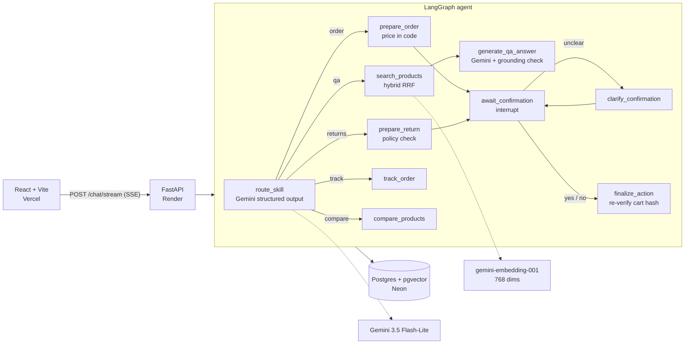

# CartAgent

A conversational shopping assistant built with **FastAPI**, **LangGraph**, **Google Gemini** and **Postgres + pgvector**, with a React front end styled as a till receipt.

The design starts from documented failures of shopping chatbots. In *Moffatt v. Air Canada* (2024) an airline was held liable for a refund policy its chatbot made up. A Chevrolet dealer's bot was talked into "agreeing" to sell a car for $1. CartAgent is built so that cannot happen here:

- **The LLM never produces a price.** Carts, totals, shipping and tax are computed in code from the catalog. Any dollar amount in a written answer that is not in the retrieved data causes that answer to be replaced.
- **Policy decisions are made in code and cited.** Cancellation and return eligibility is a pure function over the order and the clock, and every reply quotes the clause it relied on (`[§3]`).
- **Nothing irreversible happens without a human.** Orders, cancellations and returns pause the graph (LangGraph `interrupt`) until the customer approves. The approval must carry a one-time token bound to that pending action.

## What it can do

| Skill | Example | What happens |
|-------|---------|--------------|
| Q&A (hybrid RAG) | "wireless headphones under $150" | Router extracts filters → pgvector + full-text search fused with RRF → Gemini answers from the hits |
| Order (HITL) | "two of the ProBook please" | Router resolves products from history → cart priced in code → approve → stock reserved in a transaction |
| Track | "where is my order?" | Orders for the session, with a simulated processing → shipped → delivered clock |
| Returns (HITL) | "cancel my order" / "I want a refund" | Eligibility checked against the returns policy → cited → approve → status updated |
| Compare | "ProBook vs UltraBook" | Side-by-side rows built from catalog data, with differing values marked |

Each turn costs at most **two** Gemini calls: one structured routing decision, which also does the on-topic check and extracts filters, products and order ids, and one written answer, made only for Q&A. Every other skill is deterministic.

## Architecture



All state lives in one Postgres database: products with their 768-dimension embeddings, a generated `tsvector` for keyword search, LangGraph checkpoints, sessions, orders with order lines, and the daily LLM usage counter. Locally it runs in the `pgvector/pgvector` container; in production it runs on Neon.

### Abuse and safety controls

- Session ids are 256-bit random tokens issued by the server and sent in the `X-Session-Id` header. A client-made or unknown id is rejected, so one visitor cannot read or confirm another visitor's orders.
- Each LLM call first takes an atomic slot from both a per-session cap and a global daily cap. When either runs out, the API returns `429` with `Retry-After`.
- A per-IP token bucket keys on the right-most `X-Forwarded-For` entry only when `TRUST_PROXY=true`.
- At most 20 streams run concurrently and one per session, each with a 60-second timeout.
- Prompts mark catalog and conversation text as data, not instructions. Router output is checked against the catalog: unknown ids, brands and categories are dropped, and quantities and prices are clamped.
- Model markdown is rendered without raw HTML, images or non-https links, under a strict CSP.
- Prompts are not logged unless `LOG_PROMPTS=true`; logs carry a hashed session reference.

## Quick start

Requirements: Docker, [uv](https://docs.astral.sh/uv/), Node 20+, and a free [Gemini API key](https://aistudio.google.com/apikey).

```bash
cp .env.example .env          # set GOOGLE_API_KEY
make build && make up         # Postgres on :5433, migrations, API on :8000
make index                    # embed the catalog into pgvector (run in a second terminal)

cd frontend && cp .env.example .env && npm install && npm run dev   # http://localhost:5173
```

`/health` returns `503` until `make index` has stored embeddings for the configured model. If you change `GEMINI_EMBEDDING_MODEL`, re-run `make index`; vectors are keyed by model, so the old ones stay and rolling back is just switching the variable back.

## Development

```
make test     start Postgres and run the backend suite (real database; LLM and embeddings faked)
make lint     ruff check + format check
make eval     live router benchmark against Gemini; writes evaluation/results.json, served at /evals
make migrate  apply app/db/schema.sql and the checkpoint tables
cd frontend && npm test && npm run e2e    Vitest + axe, Playwright against a mocked stream
```

## Deploying for free

| Piece | Host | Notes |
|-------|------|-------|
| Database | [Neon](https://neon.com) free | pgvector included; suspends when idle |
| API | [Render](https://render.com) free web service, from `render.yaml` | Sleeps after 15 minutes idle; the UI shows a "warming the printer" banner during the cold start of about a minute |
| Front end | [Vercel](https://vercel.com) Hobby, root directory `frontend/` | Static build; the CSP in `vercel.json` allows only the API origin |

1. Create a Neon project. Using the owner connection string, run `DATABASE_URL=<owner-url> uv run python -m app.db.migrate`, then `DATABASE_URL=<owner-url> uv run python -m embedding.index`.
2. Create a `cart_app` role in Neon, run `app/db/grants.sql` as the owner, and use the `cart_app` connection string for the API. The runtime role cannot change the schema.
3. On Render, create a Blueprint from this repo. Set `GOOGLE_API_KEY`, `DATABASE_URL` (the `cart_app` URL) and `CORS_ORIGINS` (your Vercel URL).
4. On Vercel, import the repo with root directory `frontend` and set `VITE_API_URL` to the Render URL. If Render gives your service a different hostname than `cartagent-api.onrender.com`, update `connect-src` in `frontend/vercel.json`.

The Gemini free tier may use prompts to improve Google's products and is not available for apps served to users in the EEA, UK or Switzerland. This demo uses invented products and orders, and the UI says so.

## Project structure

```
app/
├── agent/      graph, skills (nodes), turn runner, confirmation parsing, decision sanitizing, response blocks
├── llm/        Gemini factory, router, answer writer, prompts, grounding check
├── order/      pricing (cart + mandate hash), returns policy, fulfilment clock, Postgres repository
├── product/    catalog loader, hybrid search repository
├── db/         schema.sql, migrate, grants.sql
├── session.py  server-issued sessions and LLM budget
├── rate_limit.py
└── main.py     FastAPI app factory, endpoints, SSE
embedding/      offline indexer (catalog → pgvector)
evaluation/     router + prompt-injection benchmark
frontend/       React + Vite + Tailwind "Receipt Tape" UI
tests/          backend tests against a real Postgres
```
